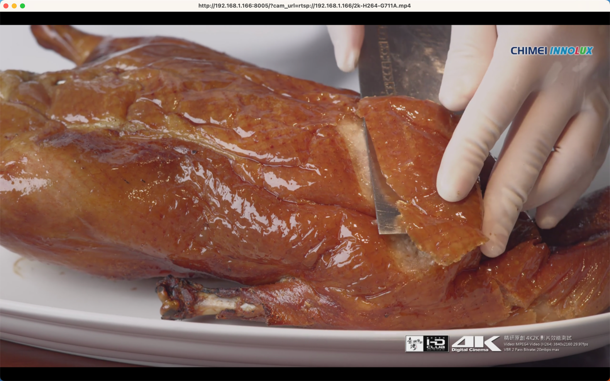
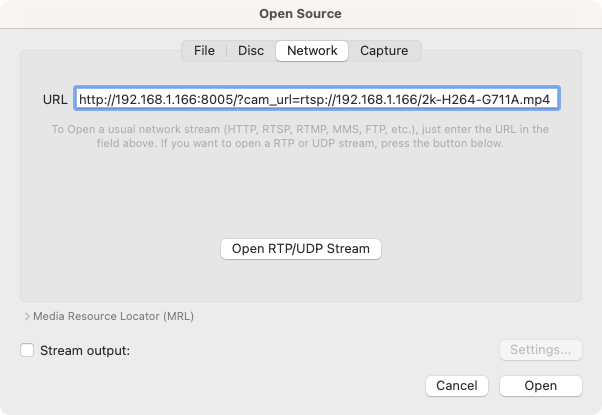
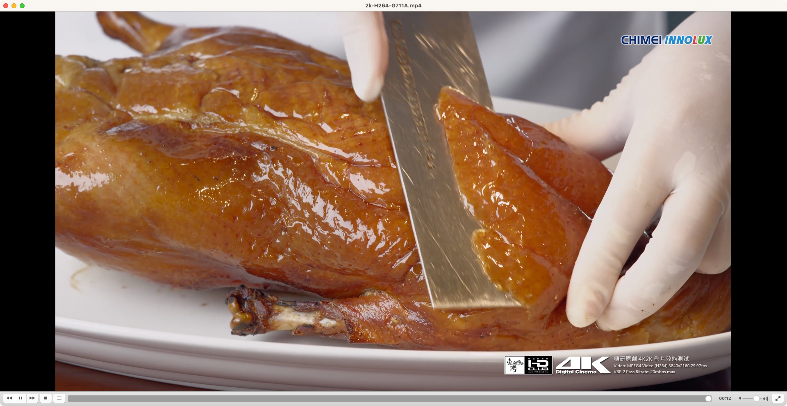
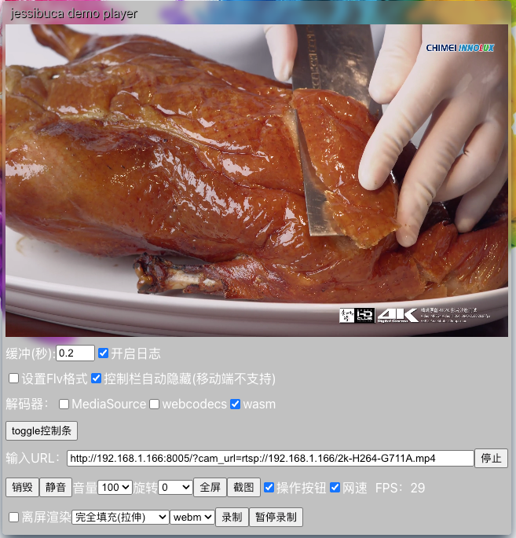
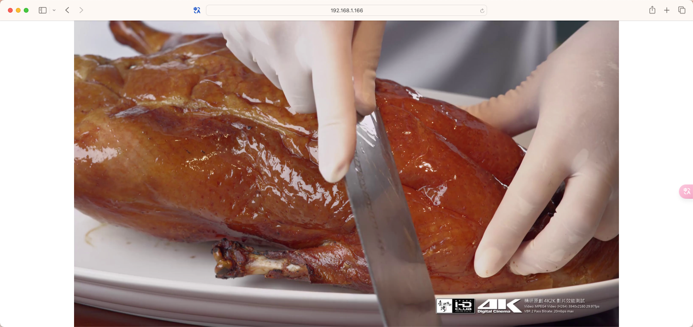
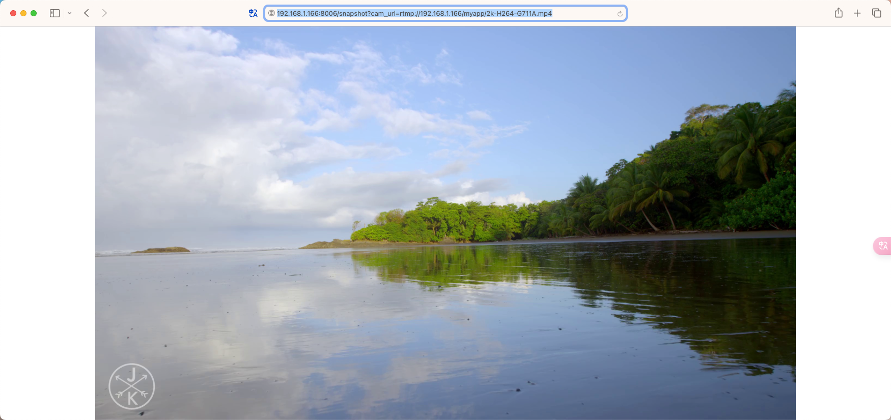

# CAM-HTTPFLV


<p align="left">
        <a href="README_CN.md">中文</a> &nbsp ｜ &nbsp English &nbsp
</p>

CAM-HTTPFLV provides two core features:
- Convert various RTSP and RTMP video streams to HTTP-FLV live streams (playable in modern browsers)
- Capture snapshots from RTSP or RTMP streams and return them as JPG images

This documentation briefly introduces supported video formats, core functionalities, and how to use CAM-HTTPFLV.

## Table of Contents
- CAM-HTTPFLV
  - [Introduction](#introduction)
  - [Supported Video Formats](#supported-video-formats)
  - [Installation](#installation)
    - [Install via Docker (Recommended)](#install-via-docker-recommended)
    - [Install from Source](#install-from-source)
  - [Optional Authentication](#optional-authentication)
  - [Live Streaming via HTTP-FLV](#live-streaming-via-http-flv)
  - [Snapshot Capture](#snapshot-capture)
    - [RTSP Snapshot Example](#rtsp-snapshot-example)
    - [RTMP Snapshot Example](#rtmp-snapshot-example)

## Introduction

In projects involving video structuring, smart surveillance, and smart cities, it’s often necessary to access camera streams in real time. However, RTSP and RTMP streams are not natively supported in web browsers.

In China, HTTP-FLV has become a widely adopted standard for low-latency live streaming across major platforms such as Douyin, Kuaishou, and Douyu.

To address the browser compatibility issues with RTSP/RTMP while staying within the HTTP-FLV ecosystem, we developed CAM-HTTPFLV.

## Supported Video Formats

The following formats have been tested and verified for compatibility:

| Input Protocol | Video Codec | Resolution         | Audio Codec | Output Protocol | Output Video Codec | Output Audio Codec |
|----------------|-------------|--------------------|-------------|------------------|---------------------|---------------------|
| RTSP           | h264        | 720p/1080p/2k/4k   | G711A       | HTTP-FLV         | h264                | AAC                 |
| RTSP           | h264        | 720p/1080p/2k/4k   | AAC         | HTTP-FLV         | h264                | AAC                 |
| RTSP           | h264        | 720p/1080p/2k/4k   | G711U       | HTTP-FLV         | h264                | AAC                 |
| RTSP           | h264        | 720p/1080p/2k/4k   | G722        | HTTP-FLV         | h264                | AAC                 |
| RTSP           | h264        | 720p/1080p/2k/4k   | G726        | HTTP-FLV         | h264                | AAC                 |
| RTSP           | h264        | 720p/1080p/2k/4k   | OPUS        | HTTP-FLV         | h264                | AAC                 |
| RTSP           | hevc        | 720p/1080p/2k/4k   | G711A       | HTTP-FLV         | hevc                | AAC                 |
| RTSP           | hevc        | 720p/1080p/2k/4k   | AAC         | HTTP-FLV         | hevc                | AAC                 |
| RTSP           | hevc        | 720p/1080p/2k/4k   | G711U       | HTTP-FLV         | hevc                | AAC                 |
| RTSP           | hevc        | 720p/1080p/2k/4k   | G722        | HTTP-FLV         | hevc                | AAC                 |
| RTSP           | hevc        | 720p/1080p/2k/4k   | G726        | HTTP-FLV         | hevc                | AAC                 |
| RTSP           | hevc        | 720p/1080p/2k/4k   | OPUS        | HTTP-FLV         | hevc                | AAC                 |
| RTMP           | h264        | 720p/1080p/2k/4k   | G711A       | HTTP-FLV         | h264                | AAC                 |
| RTMP           | h264        | 720p/1080p/2k/4k   | AAC         | HTTP-FLV         | h264                | AAC                 |
| RTMP           | h264        | 720p/1080p/2k/4k   | G711U       | HTTP-FLV         | h264                | AAC                 |

## Installation

Ensure TCP ports 8005 and 8006 are available before installation:
- Port 8005 is used for HTTP-FLV live streaming
- Port 8006 is used for snapshot capture

Assume your server IP is `192.168.1.166`.

### Install via Docker (Recommended)

```bash
docker run -itd -p 8005:8005 -p 8006:8006 \
 --restart=always --name=cam-httpflv \
 zhoukunpeng505/cam-httpflv:latest
```

### Install from Source

Ensure your Python version is >= 3.9.x. It is recommended to use a Linux system, such as Ubuntu.

```bash
git clone git@github.com:zhoukunpeng504/CAM-HTTPFLV.git
cd CAM-HTTPFLV
pip3 install -r requirements.txt
python3 server.py
```

### Feature 1: Convert Video Stream to HTTP-FLV

URL format:
```
http://192.168.1.166:8005/?cam_url=XX
```
- Replace `XX` with your video stream URL, e.g.,  
  `rtsp://192.168.1.166/720p-H264-AAC.mkv`  
  or  
  `rtmp://192.168.1.166/myapp/720p-H264-AAC.mkv`

Supported players: VLC, ffplay (from ffmpeg), jessibuca, flv.js

### Feature 2: Snapshot from Live Stream

URL format:
```
http://192.168.1.166:8006/snapshot?cam_url=XX
```
- Replace `XX` with the stream URL.

Send a GET request to retrieve the current snapshot in JPG format.


## Optional Authentication

**Authentication is disabled by default.** When `PRIVATE_KEY` is unset or an empty
string, anyone who can reach the service can request HTTP-FLV streams and snapshots
without a signature. The unsigned URLs elsewhere in this README assume this default.

Authentication is optional and can be enabled independently of the other settings.
Set a nonempty `PRIVATE_KEY` to enable it for **both** the HTTP-FLV service on port
8005 and the snapshot service on port 8006; both use the same key.

For a source deployment, start the service with:

```bash
export PRIVATE_KEY='replace-with-your-secret'
python3 server.py
```

For Docker, build an image containing this feature and pass the key to the container:

```bash
docker build -t cam-httpflv:local .
docker run -d --name cam-httpflv -p 8005:8005 -p 8006:8006 \
  -e PRIVATE_KEY='replace-with-your-secret' cam-httpflv:local
```

To disable authentication again, start the service with `PRIVATE_KEY` unset or empty
(recreate a Docker container with the updated environment).

When authentication is enabled, every stream or snapshot request must include these
URL query parameters:

- `cam_url`: the original camera URL. Sign its decoded value, including any `.flv`
  suffix, before URL-encoding it for the HTTP request.
- `time`: a Unix timestamp in integer seconds. Its absolute difference from the
  server's current time must be **strictly less than 300 seconds**. Both past and
  future timestamps are checked; exactly 300 seconds is rejected. Keep the signing
  machine and server clocks synchronized.
- `md5`: the 32-character lowercase hexadecimal MD5 of
  `cam_url + str(int(time)) + PRIVATE_KEY`, encoded as UTF-8, with no separators.

Generate signed URLs on a trusted backend with the same `PRIVATE_KEY` environment
variable as the service. Keep the key on the trusted backend; send only the resulting
URL to the player or snapshot client. For example:

```python
import hashlib
import os
import time
from urllib.parse import urlencode

cam_url = 'rtsp://camera/live?channel=1&token=a+b'
timestamp = str(int(time.time()))
private_key = os.environ['PRIVATE_KEY']
signature = hashlib.md5((cam_url + timestamp + private_key).encode('utf-8')).hexdigest()
query = urlencode({'cam_url': cam_url, 'time': timestamp, 'md5': signature})
print('HTTP-FLV:', 'http://192.168.1.166:8005/?' + query)
print('Snapshot:', 'http://192.168.1.166:8006/snapshot?' + query)
```

Replace the camera URL and server address with your own values. `urlencode` preserves
characters such as `&` and `+` inside the camera URL. Open the generated HTTP-FLV URL
in a supported player, or send a GET request to the generated snapshot URL to receive
a JPEG. Generate a fresh signed URL for each new request or reconnect when the old
timestamp is outside the allowed window. A missing or invalid authentication parameter,
an out-of-window timestamp, or a mismatched signature returns HTTP **403** with the
response body `403`.

## Live Streaming via HTTP-FLV

Using sample RTSP stream:
```
rtsp://192.168.1.166/2k-H264-G711A.mkv
```

### 1. Play with ffplay
```bash
ffplay -i 'http://192.168.1.166:8005/?cam_url=rtsp://192.168.1.166/2k-H264-G711A.mkv'
```



### 2. Play with VLC

Open VLC > File > Open Network  
Enter the following URL:
```bash
http://192.168.1.166:8005/?cam_url=rtsp://192.168.1.166/2k-H264-G711A.mkv
```



Click "Open" to begin streaming.



### 3. Play with Jessibuca

Visit [Jessibuca Player](http://jessibuca.monibuca.com/player.html)

Enter the stream URL and click play:
```bash
http://192.168.1.166:8005/?cam_url=rtsp://192.168.1.166/2k-H264-G711A.mkv
```



## Snapshot Capture

### RTSP Snapshot Example

Stream URL:
```
rtsp://192.168.1.166/2k-H264-G711A.mkv
```

Snapshot URL:
```
http://192.168.1.166:8006/snapshot?cam_url=rtsp://192.168.1.166/2k-H264-G711A.mkv
```

Preview:



### RTMP Snapshot Example

Stream URL:
```
rtmp://192.168.1.166/myapp/2k-H264-G711A.mkv
```

Snapshot URL:
```
http://192.168.1.166:8006/snapshot?cam_url=rtmp://192.168.1.166/myapp/2k-H264-G711A.mkv
```

Preview:


