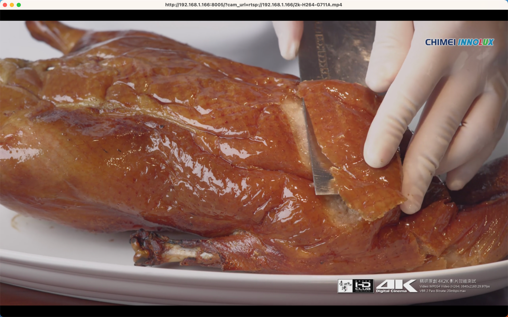
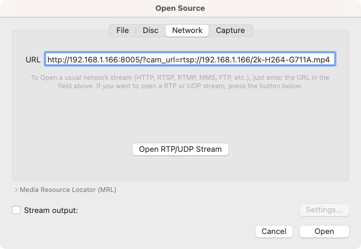
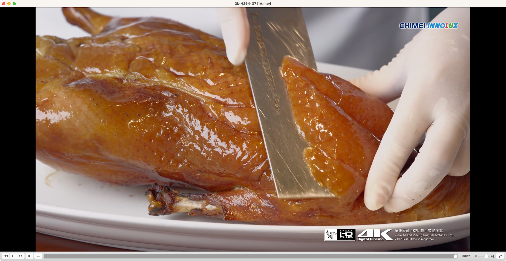
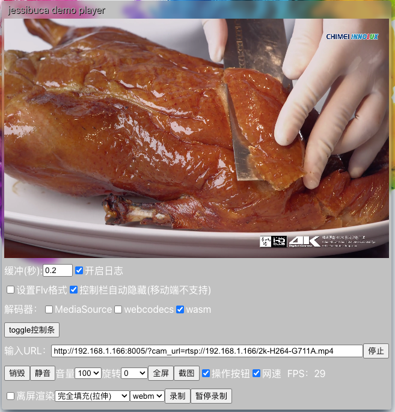
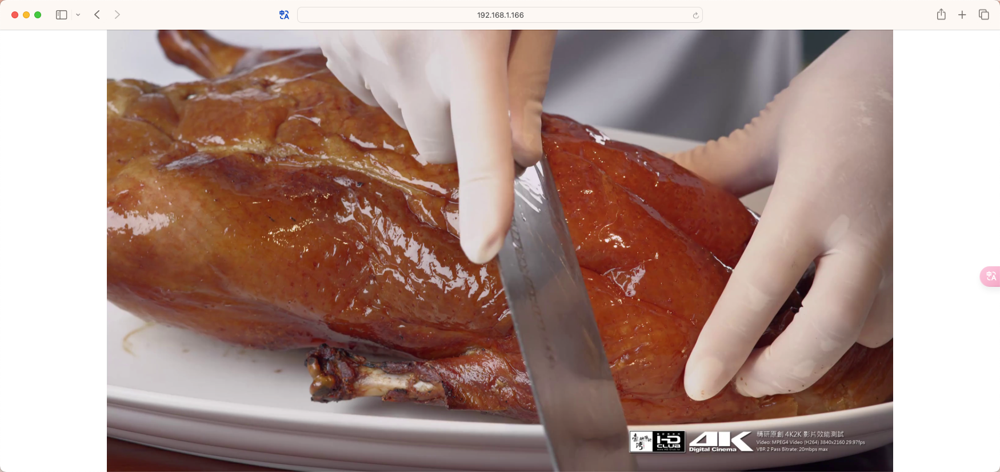
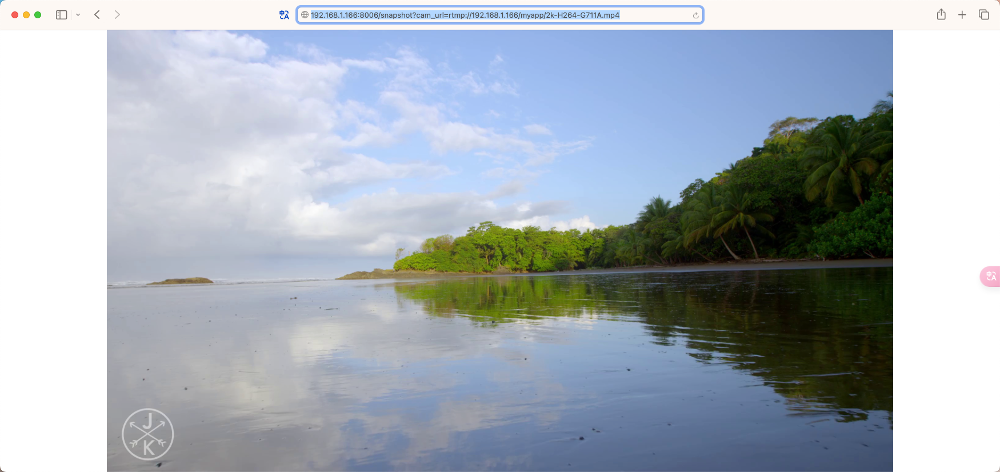

# CAM-HTTPFLV


<p align="left">
         &nbsp 中文 &nbsp | &nbsp;<a href="README.md">English</a> &nbsp 
</p>

CAM-HTTPFLV 支持两大核心功能：
- 把各种格式的RTSP、RTMP视频流转化为HTTPFLV格式的直播视频流(可支持在各种浏览器中访问)
- 对各种格式的RTSP、RTMP视频流进行在线快照，返回jpg格式的图像

在这里，我们简要介绍下CAM-HTTPFLV的支持的视频格式、主要功能以及如何使用。
## 内容
- CAM-HTTPFLV
  - [介绍](#介绍)
  - [支持的视频格式](#支持的视频格式)
  - [如何安装](#如何安装)
    - [使用docker安装(推荐)](#使用docker安装推荐)
    - [使用源码安装](#使用源码安装)
  - [视频源转HTTPFLV直播流](#视频源转httpflv直播流)
  - [视频源实时快照](#视频源实时快照)
    - [RTSP实时快照](#rtsp实时快照测试)
    - [RTMP实时快照](#rtmp实时快照测试)

## 介绍
在视频结构化、智能安防、智慧城市等项目中需要频繁对摄像机进行在线访问，
然而摄像机内置的RTSP、RTMP视频流均无法直接在浏览器中访问。
目前，在中国基于HTTPFLV协议的视频直播正在各大平台广泛使用。(如：抖音直播、快手直播、斗鱼直播等)
为了解决现有RTSP、RTMP协议在web浏览器中难以访问的困境，并保持HTTPFLV协议的兼容，
我们开发了CAM-HTTPFLV项目。

## 支持的视频格式
如下格式已经经过兼容性测试。


| 视频源格式 | 视频编码 | 分辨率           | 音频编码 | 输出格式 | 输出视频编码 | 输出音频编码 |
| ---------- | -------- | ---------------- | -------- | -------- | ------------ | ------------ |
| RTSP       | h264     | 720p/1080p/2k/4k | G711A    | HTTP-FLV | h264         | AAC          |
| RTSP       | h264     | 720p/1080p/2k/4k | AAC      | HTTP-FLV | h264         | AAC          |
| RTSP       | h264     | 720p/1080p/2k/4k | G711U    | HTTP-FLV | h264         | AAC          |
| RTSP       | h264     | 720p/1080p/2k/4k | G722     | HTTP-FLV | h264         | AAC          |
| RTSP       | h264     | 720p/1080p/2k/4k | G726     | HTTP-FLV | h264         | AAC          |
| RTSP       | h264     | 720p/1080p/2k/4k | OPUS     | HTTP-FLV | h264         | AAC          |
| RTSP       | hevc     | 720p/1080p/2k/4k | G711A    | HTTP-FLV | hevc         | AAC          |
| RTSP       | hevc     | 720p/1080p/2k/4k | AAC      | HTTP-FLV | hevc         | AAC          |
| RTSP       | hevc     | 720p/1080p/2k/4k | G711U    | HTTP-FLV | hevc         | AAC          |
| RTSP       | hevc     | 720p/1080p/2k/4k | G722     | HTTP-FLV | hevc         | AAC          |
| RTSP       | hevc     | 720p/1080p/2k/4k | G726     | HTTP-FLV | hevc         | AAC          |
| RTSP       | hevc     | 720p/1080p/2k/4k | OPUS     | HTTP-FLV | hevc         | AAC          |
| RTMP       | h264     | 720p/1080p/2k/4k | G711A    | HTTP-FLV | h264         | AAC          |
| RTMP       | h264     | 720p/1080p/2k/4k | AAC      | HTTP-FLV | h264         | AAC          |
| RTMP       | h264     | 720p/1080p/2k/4k | G711U    | HTTP-FLV | h264         | AAC          |


## 如何安装

安装前需保证TCP:8005、TCP:8006端口可用(其中8005端口用于HTTPFLV流媒体，8006端口用于对视频源进行快照)。
在这里假设服务器IP为 192.168.1.166。
### 使用docker安装(推荐)
```bash
docker run -itd -p 8005:8005 -p 8006:8006  \
 --restart=always --name=cam-httpflv  \
 zhoukunpeng505/cam-httpflv:latest
```

### 使用源码安装
安装前确保python版本>=3.9.x
```bash
git clone git@github.com:zhoukunpeng504/CAM-HTTPFLV.git
cd  CAM-HTTPFLV
pip3 install -r requirements.txt
python3 server.py
```
### 单元测试与 GitHub Actions

在项目根目录运行（仅使用 Python 标准库，无需安装视频库或启动 Redis）：

```bash
python3 -m unittest discover -s tests -v
```

`.github/workflows/unit-tests.yml` 会在每次 push、pull request 时自动运行，
也可以在 GitHub 的 Actions 页面手动触发，测试 Python 3.9、3.10、3.11、3.12。

URL 参数解析位于 `utils/request_parser.py`，由 `server.py` 的 `handle()` 调用。
测试覆盖 URL 编码、嵌套查询参数、`.flv` 后缀、`cam_type` 默认值与校验、
`allow_h265`、重复及空参数，以及错误请求返回 404 和视频任务参数传递。
处理器测试使用 mock 替代视频和网络依赖，不验证实际视频转码或 Redis 通信。

参数沿用现有规则：重复参数采用最后一个非空值；`allow_h265` 缺省或空值为 true，
去除首尾空白后仅 `true`、`1`、`True` 表示启用，其余值均为 false。
摄像头 URL 含 `&`、`+` 等字符时，应先用 `urllib.parse.urlencode` 编码为 `cam_url` 参数。

### 通过 PRIVATE_KEY 控制访问

HTTP-FLV 和 `/snapshot` 共用环境变量 `PRIVATE_KEY`。未设置或为空字符串时禁用鉴权；
非空时，每个请求的 URL 查询参数必须包含 `cam_url`、`time` 和 `md5`。
`time` 为整数秒级时间戳，与服务器当前时间的差的绝对值必须严格小于 300 秒，
过去和未来的时间戳都受此限制，恰好相差 300 秒时拒绝访问。

签名计算方式：

```python
md5 = hashlib.md5((cam_url + str(int(time)) + PRIVATE_KEY).encode('utf-8')).hexdigest()
```

`md5` 是 32 位小写十六进制字符串。`cam_url` 使用 URL 解码后的原始参数值，
包括可能存在的 `.flv` 后缀；签名在服务端去掉后缀前验证。
参数缺失、时间戳不合法或超出时间窗口、签名错误时，均返回 HTTP 403，响应正文为 `403`。

启动示例：

```bash
PRIVATE_KEY='your-secret-key' python3 server.py
```

使用 Docker 时，通过 `-e PRIVATE_KEY='your-secret-key'` 传入密钥。
可信客户端可以按如下方式生成两个服务的访问地址（密钥应保留在可信端）：

```python
import hashlib
import os
import time
from urllib.parse import urlencode

cam_url = 'rtsp://camera/live?channel=1&token=a+b'
timestamp = str(int(time.time()))
private_key = os.environ['PRIVATE_KEY']
signature = hashlib.md5((cam_url + timestamp + private_key).encode('utf-8')).hexdigest()
query = urlencode({'cam_url': cam_url, 'time': timestamp, 'md5': signature})
print('HTTP-FLV:', 'http://127.0.0.1:8005/?' + query)
print('Snapshot:', 'http://127.0.0.1:8006/snapshot?' + query)
```

### 功能1：视频源转HTTPFLV直播流
URL:http://192.168.1.166:8005/cam_url=XX
- XX: 视频源URL。如:rtsp://192.168.1.166/720p-H264-AAC.mkv、rtmp://192.168.1.166/myapp/720p-H264-AAC.mkv

如何使用？
1. 根据使用场景，拼接url，如：视频源地址为rtmp://192.168.1.166/myapp/720p-H264-AAC.mkv，则转换后的HTTPFLV视频流地址为：
http://192.168.1.166:8005/cam_url=rtmp://192.168.1.166/myapp/720p-H264-AAC.mkv
2. 将地址填入播放器中，开始播放。目前支持的播放器：VLC、ffplay(ffmpeg)、jessibuca、flv.js


### 功能2：视频源实时快照
URL:http://192.168.1.166:8006/snapshot?cam_url=XX
- XX: 视频源URL。如:rtsp://192.168.1.166/720p-H264-AAC.mkv、rtmp://192.168.1.166/myapp/720p-H264-AAC.mkv
如何使用？
通过GET请求向该地址发起请求即可得到视频源当前的快照图片，格式为jpg。

  
## 视频源转HTTPFLV直播流
如下以rtsp://192.168.1.166/2k-H264-G711A.mkv为视频源。
在实际应用中选取rtsp、rtmp协议的视频源均可。
1. 使用ffplay 播放
```bash
ffplay -i 'http://192.168.1.166:8005/?cam_url=rtsp://192.168.1.166/2k-H264-G711A.mkv'
```


2. 使用vlc播放
在VLC菜单项中依次点击--File--Open Network
将如下的链接填入输出框：
```bash
http://192.168.1.166:8005/?cam_url=rtsp://192.168.1.166/2k-H264-G711A.mkv
```



然后点击Open




3.使用jessibuca播放
打开如下链接：[jessibuda测试地址](http://jessibuca.monibuca.com/player.html)
在网页中填入播放地址，并点击播放：
```bash
http://192.168.1.166:8005/?cam_url=rtsp://192.168.1.166/2k-H264-G711A.mkv
```




## 视频源实时快照

### RTSP实时快照测试
测试视频源地址是：rtsp://192.168.1.166/2k-H264-G711A.mkv
实时快照地址为：
http://192.168.1.166:8006/snapshot?cam_url=rtsp://192.168.1.166/2k-H264-G711A.mkv


效果预览：



### RTMP实时快照测试
测试视频源地址是：rtsp://192.168.1.166/myapp/2k-H264-G711A.mkv
实时快照地址为：
http://192.168.1.166:8006/snapshot?cam_url=rtmp://192.168.1.166/myapp/2k-H264-G711A.mkv


效果预览：



